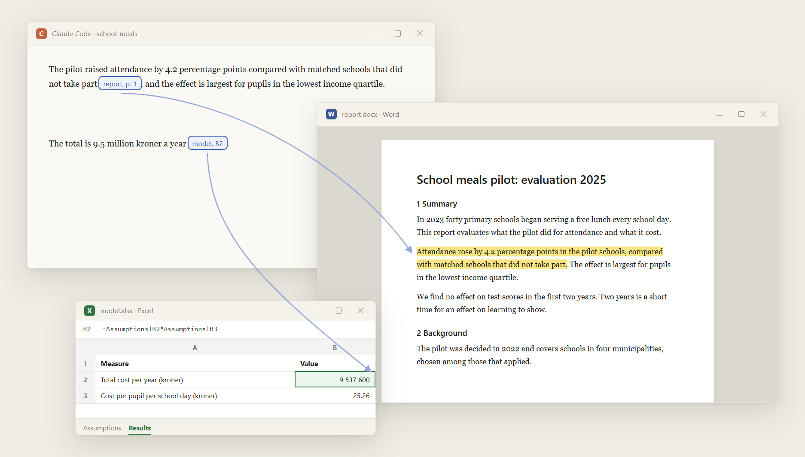
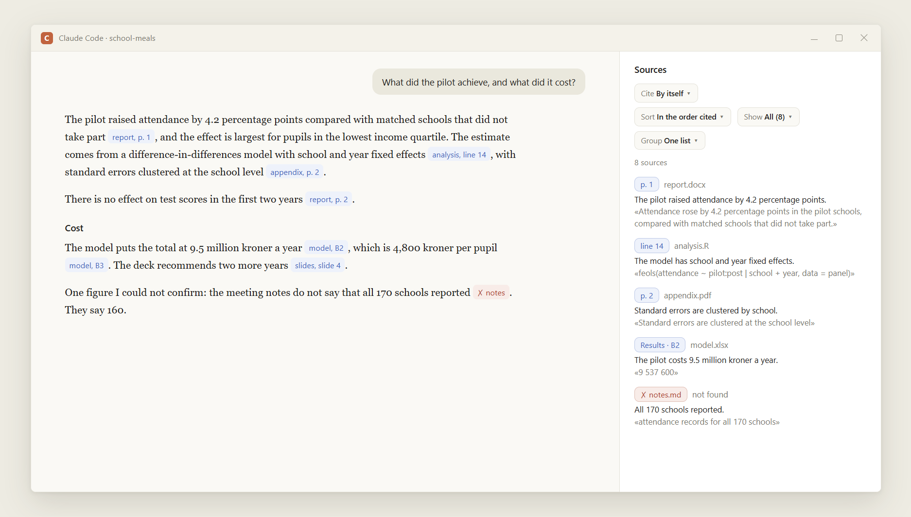
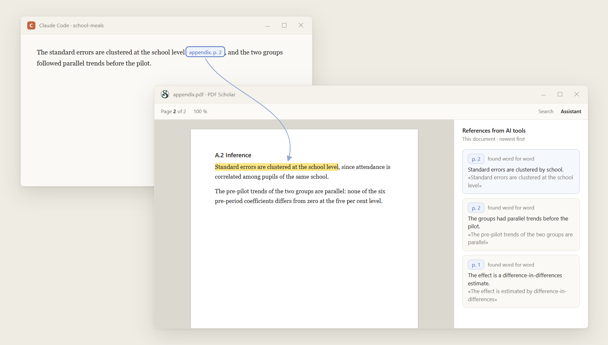

<p align="center">
  
</p>

<h1 align="center">Show your work</h1>

<p align="center"><strong>Claude's sources, one press away.</strong></p>

<p align="center">
A plugin for Claude Code that makes Claude show exactly where each claim comes
from. Every source Claude cites becomes a link in its answer. Press it and the
file opens in its own program, at the cited words.
</p>

<p align="center">
  
</p>

<p align="center"><sub>An illustration, drawn from the demo files in <code>demo/</code>. The windows are simplified.</sub></p>

## Install

You need Claude Code on Windows or macOS (on Linux, PDFs only: see
[Which systems](#which-systems)). In a Claude Code session, type:

```
/plugin install show-your-work --marketplace emilmsh/show-your-work
```

Confirm, and start a new session. That always installs the newest version.

In the desktop app you can do the same by hand: **+** next to the prompt box,
then **Plugins**, **Add marketplace** with `emilmsh/show-your-work`, then
**Add plugin**.

**Keep it up to date.** Claude Code does not update plugins from a third-party
source by itself until you tell it to. Turn it on once: `/plugin`, then
**Marketplaces**, choose `show-your-work`, and switch on auto-update. After
that Claude Code fetches new versions and says *Plugin updated: show-your-work*
when it has; `/reload-plugins` applies it at once, or it takes effect in your
next session. To update by hand instead: `/plugin`, **Installed**,
**Update now**.


## Try it

The [`demo`](demo) folder holds one small source of each kind, all about the
same made-up evaluation: a Word report, a PowerPoint deck, an Excel model, a
PDF appendix, meeting notes in Markdown and an R script. Start Claude Code in
that folder and ask:

```
What did the school meals pilot do for attendance, what did it cost, and how
sure can we be? Show me where each thing is said.
```

Then press the links in the answer.

## When Claude cites

Out of the box Claude cites by itself: whenever it tells you what a document
says, it backs the claims that matter — figures, findings, dates, quotes —
and leaves the rest. It does not cite code it is editing.

You decide how eager it is. Open the Sources pane (`/sources`) and set
**Cite**:

- **By itself**: the default.
- **When I ask**: only when you ask where something is said, or for sources.
- **Off**: the plugin offers Claude nothing. Links already in the session
  keep working.

The choice is remembered, and applies fully from your next session.

If a turn read a Word, PowerPoint, Excel or PDF file and Claude showed no
sources, a line appears above the prompt with a **Show the sources** button.
One press asks Claude to cite the claims in its last answer.

Two habits that help: name the files you want the answer from, and ask "show
me where it says that" when a claim matters to you.

## What it looks like

<p align="center">
  
</p>

Each small label in the answer is a link, named by the file and the place in
it. «report, p. 1» opens `report.docx` in Word on page 1 with the sentence
selected, and «model, B2» opens `model.xlsx` in Excel on cell B2. A quote that
is not in the file is marked ✗, so you see what Claude could not back up.

The Sources pane lists every source of the session with the claim it backs
and the words quoted. (The picture is an illustration, like the one above.)

Checking an AI's work is much easier when it takes you to the exact place it
got something from. That is the whole idea.

## What it does

- **Looks the words up in the file before Claude makes the claim.** Claude
  cites a source through one tool, `show_source`, with the words it rests on.
  The plugin finds those words in the file itself and tells Claude whether they
  are there. A quote that is not in the file comes back as *not found*, and
  Claude is told to treat the claim as unverified.
- **Puts a link in the sentence.** Claude writes a number after its claim. You
  never see the number: in its place stands the place in the source, as a
  link.
- **Opens the source at the words.** If the file is already open, you are
  taken to the place in the open file. If it is closed it is opened, and the
  program is started if it is not running.
- **Keeps a list.** A **Sources** pane lists every source of the session, with
  the claim and the quoted words. Sort it by the order cited, by file or by
  kind, filter it by kind or to the ones that were not found, and group it
  under a heading per file or per kind. `/sources` opens the pane.

## Sources it can show

| Source | Where you land | How |
| --- | --- | --- |
| Word (`.docx`, `.doc`, `.rtf`) | The page, with the quoted words selected | Word's own automation |
| PowerPoint (`.pptx`, `.ppt`) | The slide, with the words selected. Speaker notes and table cells are searched too | PowerPoint's own automation |
| Excel (`.xlsx`, `.xls`, `.csv`) | A cell, row, column, block or sheet. A cell's value is checked against the value Claude cited | Excel's own automation |
| PDF | The page, with the words marked, in [PDF Scholar](https://github.com/emilmsh/pdf-scholar) | PDF Scholar's own server |
| Text (`.md`, `.txt`, `.log`, `.tex`) | The line, with the words selected, in Notepad | Windows' accessibility interface |
| Code (`.R`, `.py`, `.do`, `.sql`, `.ts` and more) | The line and column, in VS Code. The cursor is placed there; nothing is selected | VS Code's command line |
| HTML files | The words, scrolled to and marked by your default browser | A text-fragment link |
| Web pages (`https://…`) | The same. **The page is never fetched, so the words are never checked**: the pane says *not checked* | A text-fragment link |

The table is Windows'. [Which systems](#which-systems) says what differs on
macOS and Linux.

A PDF opens in [PDF Scholar](https://github.com/emilmsh/pdf-scholar), which
marks the words on the page and keeps its own list of what Claude has pointed
at:

<p align="center">
  
</p>

<p align="center"><sub>An illustration, like the ones above.</sub></p>

## Which systems

The same tool, the same links and the same pane everywhere. What differs is
what each system lets a program be asked to do.

| | Windows | macOS | Linux |
| --- | --- | --- | --- |
| Word | Page, words selected | Page, words selected | Not shown |
| Excel | Cell, row, column, block or sheet | The same | Not shown |
| PowerPoint | Slide, words selected | Slide. The words are not selected | Not shown |
| PDF (PDF Scholar) | Page, words marked | The same | The same |
| Text | Line, words selected, in Notepad | Line and column in VS Code; without it the file opens in the default text editor, with no place | Not shown |
| Code | Line and column, in VS Code | The same | Not shown |
| HTML and web | Words marked by the browser | The same | Not shown |

- **macOS is new in 0.4.0, and not yet tried with Office.** Reading the
  files, text, HTML and the web are checked on a Mac. What asks Word, Excel
  and PowerPoint (a Word page, an Excel cell, opening any of them at the
  words) was written against their scripting dictionaries and has not run
  against the programs themselves. If it fails for you,
  [`docs/MAC-TEST.md`](docs/MAC-TEST.md) says what to send.
- **macOS.** Word, Excel and PowerPoint are driven through Apple events, so
  the first citation of each kind asks whether Claude Code (or your terminal)
  may control that program. A Word or PowerPoint quote is looked up in the
  file itself, as it was last saved; Word is asked only for the page. A
  `.ppt` file from before 2007 cannot be read: save it as `.pptx`.
- **Linux.** Office has no Linux, so the plugin cites PDFs and nothing else,
  and Claude is told so. PDF Scholar is found where a `.deb` puts it; an
  AppImage is found once a PDF Scholar later than 0.88.3 has been started with
  a tool switched on.
- **Anywhere else** the plugin installs but offers nothing.

## What you need

- Claude Code 2.1.330 or later, in the terminal or in the Code tab of the
  desktop app, on Windows 10 or 11 or on macOS.
- The programs for the sources you use: Office for Word, Excel and PowerPoint
  files, VS Code for code files (without it they open in Notepad on Windows
  and in the default text editor on a Mac).
- For PDFs, the PDF Scholar desktop app with Claude turned on under **AI
  tools** in its settings menu, and **Read together** turned on in the same
  dialog. PDF Scholar's switches decide what is shared, here as everywhere: a
  document or folder you keep out there is not shown or read here either.

## What it reads, runs and sends

- **It reads the files Claude cites**, on your machine, to look the quoted
  words up. Nothing it reads is sent anywhere by the plugin. What Claude itself
  has read of a file is a matter between you and Claude, as always.
- **It runs a script** that ships with it, and through it the programs above:
  [`scripts/show.ps1`](scripts/show.ps1) in PowerShell on Windows,
  [`scripts/show.js`](scripts/show.js) through `osascript` on a Mac. On Linux
  it runs no script.
  To check a quote in a Word or PowerPoint file that is not open, the file is
  opened invisibly and read-only, and closed again.
- **It never fetches a web page.** A web source is only opened in your browser
  when you press its link.
- **For a PDF it starts PDF Scholar's own server script**, which starts PDF
  Scholar if it is not running.
- **It keeps the session's list of sources** in the session's own state: the
  path, the quoted words, the claim and the place. The list is gone when the
  session is.

## Limits worth knowing

- **A program that is busy does not answer.** While a dialog box is open in
  Word, or a cell is being edited in Excel, the program refuses to be driven
  from outside. The plugin waits a minute and then says so.
- **The first press can be slow.** Starting Word or PowerPoint takes several
  seconds. A press says *Opening …* at once and the window follows.
- **The window may come up above the others without the keyboard.** Windows
  decides whether another program may take the keyboard. When it says no, the
  window is still put on top.
- **PDF Scholar 0.87.0 and older** make one list per citation, each numbered
  1. Later versions keep one list with the same numbers as here.
- **A link reads as an ordinary link.** The app decides how links look; the
  plugin cannot draw a chip in the middle of a sentence.
- **No links, only numbers like [1]?** Run `/reload-plugins` in the session.
  The answer is drawn again with its links. This has happened in sessions
  started right after an install or an update.

## Developing

```
claude plugin validate .
claude plugin test .
```

The tests ([`hooks/register.test.tsx`](hooks/register.test.tsx)) start no
program: they stand in for the script and for PDF Scholar's server, and check
the numbering, the answers Claude is given, the links and the pane. What the
script does to real programs is checked by hand, on a machine with Office,
VS Code and PDF Scholar: cite a passage in a file of each kind and press the
link, once with the file open and once with the program closed. On a Mac,
[`docs/MAC-TEST.md`](docs/MAC-TEST.md) says how.

Both scripts must stay plain ASCII. Windows PowerShell reads a script without
a byte-order mark as ANSI, so a character outside ASCII in a pattern changes
what the pattern matches.

Built by Emil Mathias Strøm Halseth, who reads PDFs for a living, with
assistance from Claude Code. MIT licence.
